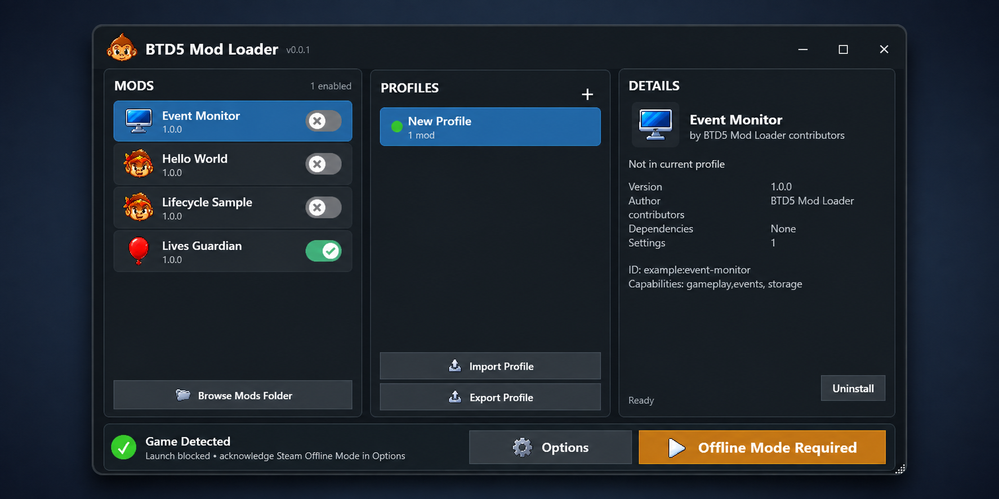

<div align="center">

# BTD5 Mod Loader

**An open-source, offline-focused Lua mod loader for Bloons TD 5.**

[](docs/compatibility.md)
[](docs/building.md)
[](CMakeLists.txt)
[](lua-api/README.md)
[](global.json)
[](LICENSE)



<sub>The Windows manager provides local mod packages, profiles, configuration, loader health, and guarded launching.</sub>

</div>

A Lua mod loader and Windows manager for the **32-bit Steam edition of Bloons TD
5**, with a native C++20 runtime and a sandboxed Lua 5.4 mod API. The verified
game target is **Steam Win32 4.8** and the public loader API is **1**.

**Start here:** [Documentation wiki](docs/README.md) ·
[Install and play](docs/getting-started.md) ·
[Write your first mod](docs/mod-authoring.md) ·
[Ten sample mods](samples/README.md)

> [!WARNING]
> Pre-alpha. Use only for offline, noncompetitive play. Put Steam in Offline
> Mode and back up your saves before experimenting. Technical network blocking,
> automatic save backups, and general crash recovery are not implemented.

This is an unofficial community project, not affiliated with or endorsed by
Ninja Kiwi. Bloons TD 5 and its assets belong to their respective owners.

## Install and run

1. [Build and stage the loader](docs/building.md), then run
   `BTD5ModLoader.Manager.exe` from `out/stage/release/`. Keep its DLLs,
   validator, and `symbols/` together when moving or sharing the bundle.
2. In **Options**, confirm the supported game directory and choose **Install loader**.
3. Create a profile with **+**, then drag a `.btd5mod` archive onto **Mods**.
4. Turn on the mod's switch in that profile; select it to configure settings.
5. Put Steam in Offline Mode, acknowledge the requirement in **Options**, and
   launch from the manager when its readiness checks pass.

Package installation and profile activation are separate. Begin with
`samples/hello-world.btd5mod` and inspect its messages in the runtime log in
Options. See the [full player guide](docs/getting-started.md) for updates,
vanilla launch, removal, and recovery.

## What you can build

| Area | Implemented behavior |
| --- | --- |
| Mod lifecycle | Isolated Lua states, load/ready/shutdown callbacks, frame timers |
| Data and settings | Per-profile configuration, mod-private string storage, English localization, packaged text reads |
| Gameplay events | 28 match, round, economy, tower, bloon, attack, and projectile events |
| Supported changes | Documented cancellation, lives replacement, cash setter, tower pop/sale-value setters, bloon health setter |
| Custom towers | Base variants, weapons, two upgrade paths, callbacks, rank/mode rules, original art, firing animation, sounds |
| Manager | Local packages, dependency/version checks, deterministic order, profiles, diagnostics, install/update/repair/uninstall |
| Compatibility | Executable/asset fingerprints, validated symbols/instructions, lifetime-checked objects |

The [API guide](lua-api/README.md), [signature reference](lua-api/reference.md),
[event contract](docs/gameplay-events.md), and [custom tower guide](docs/custom-towers.md)
describe exact fields, timing, ranges, and limits. The
[sample catalog](samples/README.md) maps ten examples to features and run steps.

See [compatibility and current limits](docs/compatibility.md) for unsupported
operations, save behavior, and interactions between mods.

## A small mod

A package has `mod.json` at its ZIP root and a Lua entry point, usually
`lua/main.lua`. This handler announces rounds:

```lua
btd5.events.on("round.started", function(event)
    btd5.log("info", "Round " .. event.round:number())
end)

function on_ready()
    btd5.log("info", "Render loop ready")
end
```

Follow [the first-mod tutorial](docs/mod-authoring.md) for the complete manifest,
editor setup, packaging, validation, installation, and offline testing. Lua mods
do not require C++ compilation. Native DLL plugins are not a public v1 format.

## Build the loader

Use Windows 10+, Visual Studio Build Tools with MSVC x86/x64 and CMake, Git,
and the exact .NET SDK pinned in `global.json`. Initial dependency restore
requires network access. From the repository root in PowerShell:

```powershell
.\scripts\install-dotnet.ps1
.\scripts\build.ps1 -Configuration Release
.\scripts\test.ps1 -Configuration Release
.\scripts\stage.ps1 -Configuration Release
.\scripts\check-docs.ps1 -Configuration Release -ValidatePackages
```

The runnable bundle and ten example archives are under `out/stage/release/`.
Ordinary native/managed tests do not require BTD5. See [building](docs/building.md)
for Debug builds, analysis/format checks, and opt-in live game acceptance.

## Documentation and contributions

The [documentation wiki](docs/README.md) is the versioned home for all current
guides. Key references:

- [Package/manifest specification](docs/mod-packages.md) and [JSON schema](schemas/mod-manifest.schema.json)
- [Compatibility, saves, and current limits](docs/compatibility.md)
- [Troubleshooting and recovery](docs/troubleshooting.md)
- [Manager workflow](docs/manager-revamp.md) and [storage/ownership](docs/manager-storage.md)
- [Architecture and source map](docs/architecture.md)
- [Native internals: pointers, object layouts, and code flow](docs/native-internals.md)
- [Contributing](CONTRIBUTING.md) and [release process](docs/releasing.md)

The loader installs tracked files beside the game; it does not patch
`BTD5-Win.exe` or `Assets/BTD5.jet` on disk. Unknown builds fail closed. Each
mod has its own restricted Lua state and validated object handles. Review a
mod's behavior and dependencies before enabling it.

Do not commit or distribute game binaries, extracted game assets, saves,
account data, credentials, or local research dumps. Bug reports should include
loader/build IDs, mod versions, reproduction steps, and relevant diagnostics.

## License and upstream work

Licensed under [GNU GPL v3.0 only](LICENSE). GPL-covered NKHook5 adaptations are
recorded with source paths and commit provenance. BTD5-Decomp is research-only;
no source is copied from it. See [upstream provenance](docs/upstream-code-provenance.md),
[research policy](docs/upstream-research.md), and
[third-party notices](THIRD_PARTY_NOTICES.md).
