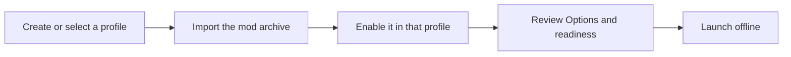

# Install and play

[Documentation home](README.md) · [Troubleshooting](troubleshooting.md)

## Before you start

You need Windows 10 or later, a legally owned Steam copy of Bloons TD 5 matching
the verified **Steam Win32 4.8** build, and a complete loader bundle. Other
storefronts, platforms, and game updates are not covered by that build ID.
See [compatibility](compatibility.md) if the manager reports a mismatch.

Use mods only in offline, noncompetitive play. Close the game, back up saves
and profile data before experimenting, and put Steam in Offline Mode. Automatic
save backups and technical network enforcement are not implemented. Steam Cloud
is separate from the game's process; account for it when keeping backups.

## Install the loader

1. Follow [building and staging](building.md) to create a complete bundle under
   `out/stage/release/`.
2. Use that folder directly or copy the complete bundle to a writable folder.
   Keep the manager, both loader DLLs, validator, and `symbols/` together.
3. Run `BTD5ModLoader.Manager.exe` from that folder.
4. Open **Options** and confirm the selected game directory. If discovery chose
   the wrong copy, select the folder containing `BTD5-Win.exe` and `Assets/`.
5. Select **Check loader**, then **Install loader** on a clean supported copy.
   Wait for a healthy result. A conflict means an existing file must be reviewed;
   the manager will preserve it.

Installation adds loader-owned files beside the game. It does not patch the
game executable or `Assets/BTD5.jet` on disk.

## Run the first sample

Installing the archive and enabling it in a profile are separate steps.

1. Create a profile with **+** in **Profiles**; use a name such as `Learning`.
2. Drag `samples/hello-world.btd5mod` from the bundle onto **Mods**.
   This installs the archive in the local package library.
3. Turn on Hello World's switch in the selected profile. Installing and enabling
   are separate actions.
4. In **Options**, acknowledge the offline requirement after putting Steam in
   Offline Mode.
5. Launch from the manager when all readiness checks pass. Close any existing
   game process first.
6. Open the live runtime log in **Options**. Look for Hello World's load and
   ready messages. Its timer follows rendered frames, so it is not a stopwatch.
7. Exit normally to allow `on_shutdown` to run.

Next, try [Event Monitor](../samples/event-monitor-mod/README.md) in a fresh
match, or the [Custom Towers](../samples/custom-tower-mod/README.md) package to
place a Plasma Monkey. The [sample catalog](../samples/README.md) lists each
package's settings, expected behavior, and gameplay effects.

## Change a profile or update a mod

1. Close the game before changing the enabled set or configuration.
2. Select the target profile. Each profile owns its mod version selection,
   enabled state, order, and configuration.
3. Select a package and use **Configure** for its settings; reset values to its
   manifest defaults when needed. Changes take effect on the next launch.
4. To update a mod, import its new version and switch the profile to that
   installed version. Keep the old version until you have checked the update.
5. Review dependency errors before launch. Reordering cannot satisfy a missing
   required dependency.

Profile export transfers the profile definition, not its package archives.
Share the matching mod versions separately when reproducing a setup.

## Disable, remove, and uninstall

| Action | Result |
| --- | --- |
| Turn a switch off | Disable that mod in the current profile, subject to dependency checks |
| Remove from profile | Remove the profile entry; retain the installed package |
| Uninstall a package | Remove the archive; blocked while any profile references that version |
| Launch vanilla in Options | Launch without a mod authorization ticket after installation checks |
| Uninstall the loader in Options | Delete only verified loader-owned files; preserve modified or foreign files |

For a custom-tower match, keep its mods available when resuming. Saves naming
missing custom towers are held aside until those IDs return. This mechanism
does not provide a general save backup or make progression changes reversible.
See [save behavior](compatibility.md#saves-and-mod-identities).
