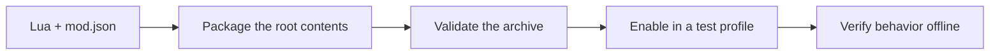

# Write your first mod

[Documentation home](README.md) · [API guide](../lua-api/README.md) ·
[Sample catalog](../samples/README.md)

This tutorial takes a Lua source folder to a validated `.btd5mod` package. Use a
text editor and a complete loader release. Building the loader is optional.



Keep `mod.json` at the archive root. Script validation and in-game verification
cover different parts of this workflow.

## 1. Create the source folder

Copy [Hello World](../samples/hello-world-mod/) to a new working folder called
`my-first-mod`. Keep `mod.json` at its root and the entry script at `lua/main.lua`.
Do not copy the Lua API definition file into the package.

Replace `mod.json` with:

```json
{
  "id": "yourname.first-mod",
  "name": "My First Mod",
  "author": "Your name",
  "version": "1.0.0",
  "entry_point": "lua/main.lua",
  "loader_api": 1,
  "supported_game_builds": ["steam-win32-4.8"],
  "dependencies": [],
  "load_order": { "before": [], "after": [] },
  "capabilities": ["gameplay.events"],
  "configuration_defaults": { "announce_rounds": true },
  "documentation": "README.md"
}
```

Write a short `README.md` describing what your mod does. Choose your own stable,
lowercase dotted ID; the manager uses IDs and versions, not folder names, to
identify packages. See the [manifest reference](mod-packages.md) for all fields.

## 2. Add behavior

Replace `lua/main.lua` with:

```lua
local announce_rounds = true

btd5.events.on("round.started", function(event)
    if announce_rounds then
        btd5.log("info", "Starting round " .. event.round:number())
    end
end)

function on_load()
    announce_rounds = btd5.config.get("announce_rounds") ~= "false"
    btd5.log("info", "My First Mod loaded")
end

function on_ready()
    btd5.log("info", "Ready to enter a match")
end
```

Register handlers while the script loads. `on_load` is suitable for reading
configuration and storage; `on_ready` means the render loop is running, not that
a match exists. Use `match.started` for match state and `round.started` for
round state. Custom towers and sounds must register at script top level,
before `on_load`.

All configuration values arrive as strings: use `== "true"` for booleans and
`tonumber` for numbers. Lua treats the string `"false"` as truthy.

## 3. Set up editor help

Add the repository's `lua-api/` directory to Lua Language Server's
`workspace.library` and set `runtime.version` to `Lua 5.4`. See the
[editor setup](../lua-api/README.md#editor-setup) for a complete `.luarc.json`.
The [signature reference](../lua-api/reference.md) is available without editor
extensions. API definition files are documentation; never execute them.

## 4. Package the contents

From the folder **containing** `my-first-mod`, run PowerShell:

```powershell
Add-Type -AssemblyName System.IO.Compression.FileSystem
$source = (Resolve-Path -LiteralPath '.\my-first-mod').Path
$destination = Join-Path (Get-Location).Path 'my-first-mod-1.0.0.btd5mod'
[System.IO.Compression.ZipFile]::CreateFromDirectory($source, $destination)
```

Choose a new destination filename if it already exists. Open the archive to
confirm `mod.json` appears at the root, alongside `lua/` and `README.md`.
`my-first-mod/mod.json` one directory down is incorrect. Use forward slashes in
manifest paths; the package validator is the final check of archive paths.

Inside this repository, `scripts/stage.ps1` packages all ten supplied examples
after a loader build. It does not package arbitrary external mod folders.

## 5. Validate before launch

Run the validator from an extracted loader release (adjust the paths):

```powershell
.\btd5loader_validate.exe .\my-first-mod-1.0.0.btd5mod
.\btd5loader_validate.exe .\my-first-mod-1.0.0.btd5mod --game 'C:\Games\BloonsTD5'
```

It prints JSON and exits `0` for valid, `1` for rejected, or `2` for invalid
command-line arguments. It checks archive/manifest rules and executes the
entry script, including tower and sound registration, without launching BTD5.
`--game` adds art-name checks when the game art catalog loads; inspect any
`warnings` because catalog failure means art names were not checked.

The validator does **not** call `on_load`, `on_ready`, timers, or gameplay
handlers. It does not resolve an entire profile's dependencies or prove gameplay
behavior. A valid result is the first check, followed by a profile check and an
offline game test.

## 6. Install and verify

1. Close BTD5. Import the archive into the manager and enable it in a dedicated
   test profile, following [player setup](getting-started.md).
2. Launch offline and check the runtime log for the mod ID, load, and ready
   messages. Start a fresh match and one round; check its round announcement.
3. Exit normally. In the manager, set `announce_rounds` to `false`.
4. Relaunch, start a round, and confirm the announcement is absent.
5. Disable the mod and launch again to confirm ordinary behavior.
6. When adding object references, test selling towers, ending a match, and
   entering another match. A stored wrapper must pass `is_valid()` before use.

Test one gameplay change at a time. Use a fresh profile for focused samples;
several mods can act on the same event, and earlier cancellation affects later
mods. See the [event contract](gameplay-events.md).

## Next features to learn

| Goal | Start here |
| --- | --- |
| Cancel or replace life loss | [Lives Guardian](../samples/lives-guardian-mod/README.md), [lives API](../lua-api/README.md#changing-the-pending-lives-value) |
| Set round cash without recursive event loops | [Round Budget](../samples/round-budget-mod/README.md) |
| Inspect or restrict tower actions | [Tower Rules](../samples/tower-rules-mod/README.md) |
| Change bloon health or cancel a bounded action | [Bloon Rules](../samples/bloon-rules-mod/README.md) |
| Read resources, translate text, and persist a setting | [Resource Notes](../samples/resource-notes-mod/README.md) |
| Add a tower, weapon, upgrades, animation, and sound | [Custom tower guide](custom-towers.md) |
| Observe every event for debugging | [API Debug Console](../samples/api-debug-mod/README.md) and [Lifecycle Sample](../samples/lifecycle-mod/README.md) |

## Share a mod

1. Keep the same mod ID for updates; increment the semantic version. An installed
   ID/version is immutable. Change the version before reimporting edited code.
2. Include a README with supported builds, loader API, installation, settings,
   dependencies, expected behavior, known limitations, and removal instructions.
3. Ship only your Lua, metadata, original or appropriately licensed assets, and
   license/credits. Reference vanilla art by its name instead of redistributing it.
4. Validate the final archive, test it from a fresh profile, and record the loader
   version, game build, and checks you performed.
5. If your mod registers content, keep its public IDs stable across versions and
   explain what happens to saved matches if it is removed.
6. Share the `.btd5mod` file and its source/license. Players import the archive;
   they do not need to copy scripts into the game installation.

There is no public native-plugin ABI, `require`, networking, or arbitrary file
access. Multiple Lua files do not load automatically. Keep runtime code in the
entry script for now; packaged resources are data, not executable modules.
