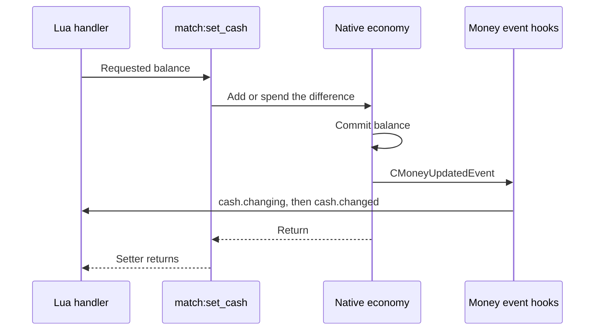

# Native internals: pointers and code flow

[Documentation home](README.md) · [Architecture](architecture.md) ·
[Gameplay event contract](gameplay-events.md)

This reference describes the **Steam Win32 4.8** executable, build ID
`steam-win32-4.8`. It connects the native research to the loader implementation.
Lua mods use [validated object methods](../lua-api/reference.md); these layouts
are for understanding the native runtime.

## Addresses and compatibility

The canonical [symbol map](../symbols/btd5-steam-4.8.json) records executable
and asset SHA-256 fingerprints, signatures, offsets, and expected instructions.
Both fingerprints must match before hooks are installed. Each required symbol
must resolve and pass its instruction checks; a version label is insufficient.

Addresses below are relative virtual addresses (**RVAs**):
`loaded address = actual module base + RVA`. The executable's preferred image
base is `0x400000`; subtract that value when converting an address from a
disassembler using the preferred base. Do not assume the loaded base is fixed.
Object offsets such as `tower + 0xD0` are byte offsets from a live object.

## Native object layouts

These are the fields consumed by the runtime, not complete class definitions.
The accessors and checks are in [runtime.cpp](../src/native/runtime/runtime.cpp).

| Receiver | Offset | Native value | Meaning |
| --- | --- | --- | --- |
| Tower | `+0xD0` | `uint64` | Native tower type flag |
| Tower | `+0x138`, `+0x13C` | Two `int32` values | Upgrade tiers, each `0..4` |
| Tower | `+0x144` | `int32` | Base sale value used by the native payout path |
| Bloon | `+0x1FC` | Pointer | Bloon definition |
| Bloon definition | `+0x28` | `uint64` | Bloon type flag |
| Bloon | `+0x220` | Byte | Popping flag |
| Bloon | `+0x224` | `float` | Health |
| Round | `+0x14` | `int32` | One-based round number |
| Game screen / match | `+0x53C` | Pointer | Economy object |
| Economy | `+0x90` | `double` | Cash balance |

The cash pointer chain is `screen -> [screen+0x53C] -> [economy+0x90]`.
The bloon type chain is `bloon -> [bloon+0x1FC] -> [definition+0x28]`.
Bloon `+0x204` contains other flags; it is not the type key. Tower pop count
has a layout lead at `+0xEC`, but the implementation uses the verified native
getter and setter rather than writing that offset directly.

Vanilla types use category-0 registration order: bit `i` names entry `i`.
The tower factory is at RVA `0x1E0B80`; the bloon factory is at `0x1AEB20`.
[object_types.hpp](../src/native/runtime/object_types.hpp) contains all 60 tower
and 20 bloon names. Examples: `DartMonkey = 0x2`, `MonkeySub = 0x800000`,
`Red = 0x2`, `Golden = 0x1000`, and `MOAB = 0x2000`. Vanilla type lookup
returns no name for zero, multiple bits, or a bit outside its table; Lua sees
`nil` instead of a guessed type. Custom towers use the separate encoding below.

## Lifetimes and native dispatch

A Lua wrapper identifies an object by kind, registry slot, generation, and scene
lifetime. It does not expose a native address. Destruction or scene reset
invalidates the handle; a later allocation at the same address gets a fresh
generation. See [game_object.cpp](../src/native/runtime/game_object.cpp).

The native round receiver can be reused between rounds. The loader therefore
invalidates the previous round wrapper and creates a fresh lifetime even when
its address stays the same. The round-start producer is at RVA `0x228A00`;
the required `round.number.write` site at `0x228AF3` pins its `+0x14` field.

The native event manager can release event storage during dispatch. Hooks copy
payloads before calling the original dispatcher, then use the copy for the
after-event callback. Reading the event allocation after native dispatch is
unsafe. The public contract specifies which wrappers survive each callback.

For attacks, the native object is `CWeapon`. Projectile lifetimes come from the
three `CProjectile` constructors. All entries below use x86 `__thiscall` with
the receiver in `ECX`; argument counts exclude the receiver.

| Symbol | RVA | Stack arguments / return cleanup |
| --- | --- | --- |
| `attack.constructor` | `0x2E7180` | 2 arguments; `ret 8` |
| `attack.destructor` | `0x2E7480` | No arguments; plain `ret` |
| `projectile.constructor.primary` | `0x2FC970` | 4 arguments; `ret 0x10` |
| `projectile.constructor.secondary` | `0x2FCC80` | 4 arguments; `ret 0x10` |
| `projectile.constructor.tertiary` | `0x2FCF80` | 6 arguments; `ret 0x18` |
| `projectile.destructor` | `0x2FD2D0` | No arguments; plain `ret` |

Created callbacks run after native construction. Destroyed callbacks run before
native destruction, with handles invalidated after the handlers return. Only
objects in a live match scene are exposed; asset-loading factory prototypes
are excluded. Events dispatch only when a loaded mod subscribes.
The detours are implemented in
[object_lifetime_hook.cpp](../src/native/runtime/object_lifetime_hook.cpp).

## Cash code flow

`match:set_cash(value)` uses native economy helpers so the game updates its own
observers and HUD. It reads the balance, computes the difference, and invokes
`cash.add` (RVA `0x26C310`) or `cash.spend` (`0x26C3C0`). An unchanged balance
requires no helper call. The verified economy-pointer read is at `0x32C264`.

Both helpers take the economy pointer in `ECX` and a double-precision amount in
`XMM1`, then use plain `RET`. Treating the amount as an ordinary stack argument
would use the wrong calling convention. Spend clamps the balance at zero.

Both cash events observe the committed balance; `cash.changing` is before
native observer dispatch, not before the cash write. Nested money callbacks
can occur before the setter returns. [ModDispatchGate](../src/native/runtime/mod_dispatch.hpp)
admits same-thread reentry, makes other threads wait, and refuses dispatch once
shutdown begins. Nested callbacks still share the host's recursion and work budgets.

## Lives and tower decisions

Lives handlers accept or reject an update according to game-mode rules before
reaching their mutation instructions. Hooking only handler entry would announce
updates that might never happen. The loader therefore uses both the accepted
write boundary and the complete handler:

| Boundary | RVA | Purpose |
| --- | --- | --- |
| `player.lives.gain.handler` | `0x32C490` | Snapshot before the handler; compare after return |
| `player.lives.loss.handler` | `0x32CAE0` | Same, for escaped-bloon damage |
| `player.lives.gain.write` | `0x32C4E2` | Dispatch before the accepted gain write |
| `player.lives.loss.write` | `0x32CDF6` | Dispatch before the accepted loss write |

The pre-write shim preserves registers and flags. It executes the original
operation, writes an accepted absolute replacement, or skips the write when
cancelled. Loss proposals include the game's zero clamp. The handler-level
hook emits `lives.changed` only if readable before/after values differ. See
[lives_write_hook.cpp](../src/native/runtime/lives_write_hook.cpp) and
[lives_hook.cpp](../src/native/runtime/lives_hook.cpp).

Player tower purchases have a similar distinction between decision and ownership.
The `tower.purchase.checks` site at RVA `0x3454B8` precedes the free-token check
and the cost check 12 bytes later. Cancellation bypasses both checks, returning
failure through the game's ordinary rejected-placement path before either a
token or cash is consumed. An accepted purchase is marked to prevent a duplicate
pre-event when it reaches the tower manager.

By `tower.manager.place` at RVA `0x2308D0`, the purchase is already consumed and
callers can require a live tower afterward. That boundary therefore observes
non-purchase placement without permitting cancellation. Upgrade and sale hooks
use `tower.upgrade.commit` (`0x23251C`) and `tower.sale.commit` (`0x425318`),
after native eligibility checks and before mutation or refund side effects.
See [tower_purchase_hook.cpp](../src/native/runtime/tower_purchase_hook.cpp)
and the [event contract](gameplay-events.md).

## Bloon action boundaries

The lethal-hit decision is `bloon.pop.decision`, RVA `0x23C804`. Its 17-byte
region writes health and conditionally sets the popping byte at `+0x220`.
The hook raises `bloon.popping` before that first flag commit. Cancellation
skips the commit and preserves pre-hit health, or a replacement health value
set by the handler. Repeated lethal hits on an already flagged bloon do not
raise another popping decision.

The later manager routine, `bloon.pop.commit` at `0x204780`, performs pop work.
Skipping that routine alone cannot cancel a pop: its caller still unlinks the
parent. This distinction is why the loader intercepts the lethal-hit decision.
See [bloon_action_hook.cpp](../src/native/runtime/bloon_action_hook.cpp).

Round-queue spawning is cancellable. Boss and ability spawns can immediately
consume the returned pointer, so their spawn events are observational. Child
bloons created by a pop do not pass through the round-spawn boundary. Cancelling
a leak takes the native non-leak continuation and leaves the bloon alive; it may
reach the leak boundary again. See the [event contract](gameplay-events.md) for
the exact cancellation and mutation rules.

## Custom tower identities

Public IDs are stable `modId:towerId` strings. Native type values combine tag
bit 63 with a nonzero 13-bit index distributed across these bit positions:
`60, 61, 62, 0, 50, 51, 52, 53, 55, 56, 46, 47, 59`.
These index positions avoid the supported build's vanilla targeting, locked-tower,
and quest masks. Index zero is reserved for the bare "any custom tower" tag;
the remaining encoding permits **8,191** registered custom towers.

[custom_tower_identity.hpp](../src/native/runtime/custom_tower_identity.hpp)
defines the encoding. [tower_registry.cpp](../src/native/runtime/tower_registry.cpp)
maps public IDs to definitions; the content hooks connect generated factory names,
type flags, tower data, shop entries, sprites, and upgrades. Native factory names
use `CT` followed by the 16 hexadecimal digits of an FNV-1a 64-bit ID hash.
Persistence uses the stable public ID, not the registration index.

Generated content is served through the loader's file overlay without patching
`Assets/BTD5.jet`. Custom progression is mod-owned, and missing custom IDs cause
affected match saves to be held aside. See [custom towers](custom-towers.md) and
[save behavior](compatibility.md#saves-and-mod-identities).

The optional `BTD5ML_DIAG_TYPE_WATCH` diagnostic watches the first placed tower's
type at `+0xD0` and `+0xD4` using hardware read/write breakpoints. When the game
copies that value to a popped bloon's `+0x250`, it can follow the latest copy.
Watchpoints trap after access: `after` identifies the following instruction;
`frame` is meaningful only when the reader retains an EBP frame pointer. See
[type_watch.hpp](../src/native/runtime/type_watch.hpp) for thread coverage and limits.

## Shutdown code flow

After the game-main call at RVA `0x527440`, the CRT reaches `game.exit.call`
at `0x527447`. The original no-argument predicate at `0x527EBA` checks the
executable's managed-image directory. The loader preserves its boolean result
and the CRT's resulting exit continuation.

[exit_hook.cpp](../src/native/runtime/exit_hook.cpp) verifies the relative CALL
target, atomically replaces its aligned four-byte displacement, and restores
page protection and instruction-cache coherence. This hook is installed first
and removed last. Cleanup runs on the thread returning from game main, before
CRT teardown and outside `DllMain` and the loader lock.

Shutdown stops new dispatch, drains admitted Lua work, invalidates game wrappers,
then calls `on_shutdown` in reverse load order. Logging, private storage, and
packaged resources remain available until callbacks finish. An explicit native
shutdown request keeps inert hooks and trampolines installed until normal game
exit so returning native detours stay valid. Runtime DLL unloading during play
is unsupported. Forced termination and crashes can skip this cleanup.

## Research sources and attribution

The symbol map and linked implementation are the precise source references for
these layouts and boundaries. Upstream research leads and source adaptations
are recorded in [research sources](upstream-research.md) and the
[provenance ledger](upstream-code-provenance.md). Game binaries, extracted
assets, and decompiled game source are not distributed in this repository.
