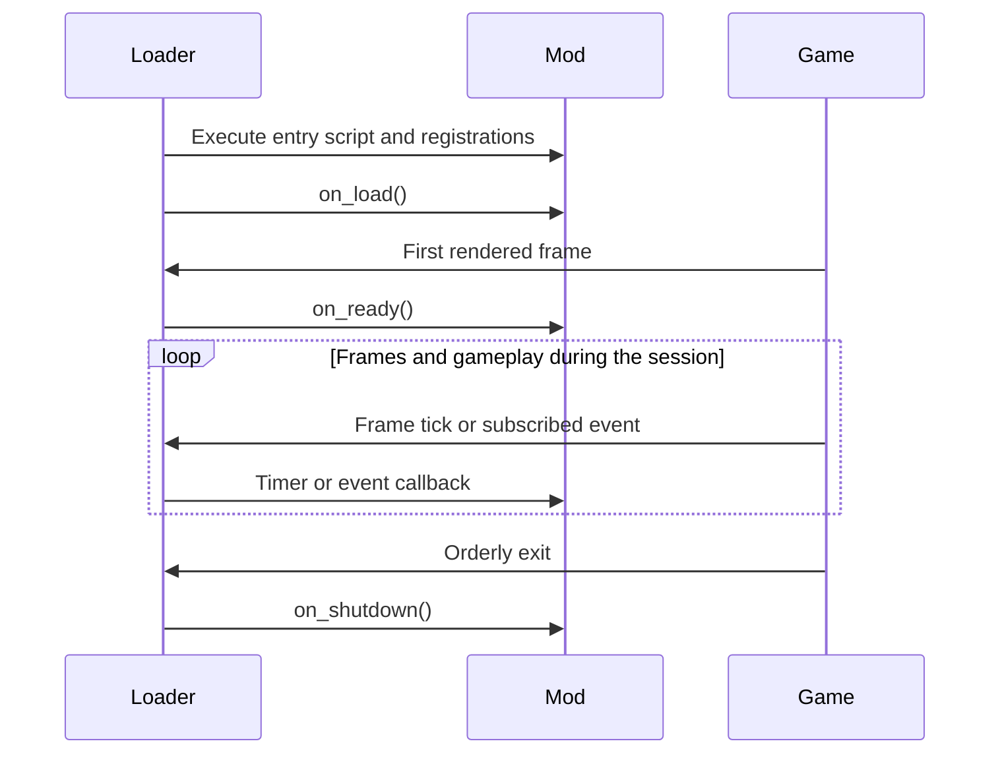

# BTD5 Mod Loader Lua API v1

[Documentation home](../docs/README.md) · [First mod tutorial](../docs/mod-authoring.md) ·
[Custom towers](../docs/custom-towers.md) · [Samples](../samples/README.md)

Lua 5.4 is the public modding API. Every enabled mod runs in an isolated,
sandboxed Lua state with its own globals, subscriptions, timers, configuration,
storage, and resource directory.

This reference describes features implemented in the supported Steam Win32 4.8
build. Custom towers, sounds, identity getters, and the validated setters listed
below are implemented. General access to arbitrary gameplay properties is not
exposed.

Use the compact [Markdown signature reference](reference.md) while authoring a
mod. For editor autocomplete and diagnostics, add the documentation-only
[`btd5.lua`](btd5.lua) definition file to your Lua Language Server workspace.
Do not package or execute that file with a mod.

## Quick start

A minimal mod contains two files:

```text
hello-world/
├── mod.json
└── lua/
    └── main.lua
```

`mod.json`:

```json
{
  "$schema": "../../schemas/mod-manifest.schema.json",
  "id": "example.hello-world",
  "name": "Hello World",
  "author": "Your name",
  "version": "1.0.0",
  "entry_point": "lua/main.lua",
  "loader_api": 1,
  "supported_game_builds": ["steam-win32-4.8"],
  "dependencies": [],
  "load_order": { "before": [], "after": [] },
  "capabilities": []
}
```

`lua/main.lua`:

```lua
function on_load()
    btd5.log("info", "Hello World loaded")
end

function on_ready()
    btd5.log("info", "The game render loop is ready")
end
```

Package the contents—not the containing directory—as a ZIP archive and rename
it to `.btd5mod`. The manager validates and installs the package. See the
[package specification](../docs/mod-packages.md) for manifest and archive rules.

## Execution model



Match and round events repeat during a session; `on_ready` runs once after
loading, rather than once per match. A ready render loop does not imply a live match.

The host opens Lua's base, table, string, math, and UTF-8 libraries.
Coroutines are unavailable until the host can enforce resume and close budgets.
`setmetatable` rejects metatables containing `__gc` or `__close`; use explicit
lifecycle callbacks for cleanup. Other metatable behavior remains available.
Use `btd5.log` instead of relying on console output.

The following lifecycle functions are optional:

Callbacks must be functions stored directly in the global table. The host does
not consult `_G.__index` when a callback is absent.

| Callback | Timing |
| --- | --- |
| `on_load()` | Runs while the enabled profile is loading. The game scene is not ready. |
| `on_ready()` | Runs once on the first rendered frame after all enabled mods load. |
| `on_shutdown()` | Runs during an orderly loader shutdown. |

Normal game exit now invokes shutdown in reverse mod load order. Game-object
handles are invalid before these callbacks run; storage and packaged resources
remain available until callbacks finish. A failing callback does not prevent
other mods from shutting down. Crashes and forced termination cannot guarantee
callbacks or cleanup. See the [shutdown contract](reference.md#optional-lifecycle-callbacks).

A callback error is logged with the mod ID and callback name. The failing
callback is disabled when continuing is safe; other callbacks and mods continue.

## Host API reference

### Logging

```lua
btd5.log(level, message)
```

`level` and `message` must be strings. `"error"` produces an error record;
other levels currently produce an informational record.

### Configuration

```lua
local value = btd5.config.get(key)
```

Returns the profile configuration value as a string, or `nil` when the key is
missing. JSON booleans and numbers are serialized as strings, so parse them
explicitly:

```lua
local enabled = btd5.config.get("enabled") == "true"
local threshold = tonumber(btd5.config.get("threshold") or "10")
```

Defaults are declared in `mod.json` under `configuration_defaults`.

### Private storage

```lua
local value = btd5.storage.get(key)
btd5.storage.set(key, value)
```

Keys and values are strings. Missing keys return `nil`. Storage is private to
the mod ID and persists between launches. Keys are limited to 128 bytes and
values to 64 KiB. Mods using this API should declare the `storage` capability.

### Localization

```lua
local text = btd5.localization.get(key)
```

Returns the active localized value, or the key itself when no value exists.
Localization files are declared by the manifest and stored under
`localization/`. The current runtime reads `localization/en-US.json`, a flat
string-to-string object. Locale selection and formatted placeholders are not implemented.

### Packaged text resources

```lua
local contents = btd5.resource.read_text("assets/example.txt")
```

Reads a file from the extracted mod package. Paths must use `/`, remain
relative, and contain no `.` or `..` components. The file must exist and be no
larger than 1 MiB. This API never exposes a general filesystem path.

### Deterministic timers

```lua
btd5.timer.after(ticks, callback)
```

Schedules a one-shot callback after a non-negative number of ticks. Currently,
one tick is one rendered frame, not one simulation step or a fixed duration.
Timers with the same due tick run in registration order.

```lua
btd5.timer.after(60, function()
    btd5.log("info", "approximately 60 rendered frames passed")
end)
```

### Event subscriptions

```lua
local token = btd5.events.on(name, callback)
local removed = btd5.events.off(token)
```

`on` returns a positive integer subscription token. `off` returns `true` when
the active subscription was removed and `false` for an unknown or previously
removed token. A mod may have at most 256 active handlers.

Handlers run in enabled-mod load order, then subscription order. A handler added
during dispatch starts with the next event. Removing a handler takes effect
immediately. A failing handler is disabled without stopping later handlers.

```lua
local token
token = btd5.events.on("match.started", function(event)
    btd5.log("info", event.name)
    btd5.events.off(token)
end)
```

## Live gameplay events

Each mod receives its own event table, shared among that mod's handlers for
that dispatch. It always contains `name` and `cancelled`. Accepted mutations
and sticky cancellation are propagated to subsequent mods; Lua tables and
globals are not shared across their states. Payload fields depend on the event.

| Event | Payload | Timing | Cancellable |
| --- | --- | --- | --- |
| `match.starting` | `match` | Before game-screen initialization | No |
| `match.started` | `match` | After game-screen initialization | No |
| `match.ending` | `match` | Before game-screen teardown | No |
| `match.ended` | `match` (stale) | After game-screen teardown | No |
| `round.starting` | `round` | Before native round-start observer dispatch | No |
| `round.started` | `round` | After native round-start observer dispatch | No |
| `round.ending` | `round` | Before native round-end observer dispatch | No |
| `round.ended` | `round` | After native round-end observer dispatch | No |
| `cash.changing` | `cash` | Before native money-update observer dispatch; the balance is already written | No |
| `cash.changed` | `cash` | After native money-update observer dispatch | No |
| `lives.changing` | `old_lives`, `new_lives`, `player` | At the accepted native lives write | **Yes** |
| `lives.changed` | `old_lives`, `new_lives`, `player` | After a verified lives change | No |
| `tower.placing` | `tower`, `purchase` | At the purchase decision (`purchase = true`) or before tower-manager ownership | **Purchases only** |
| `tower.placed` | `tower` | After placement observer dispatch | No |
| `tower.upgrading` | `tower` | After eligibility and before upgrade mutation | **Yes** |
| `tower.upgraded` | `tower` | After upgrade observer dispatch | No |
| `tower.selling` | `tower` | After eligibility and before sale side effects | **Yes** |
| `tower.sold` | `tower` | After sale observer dispatch | No |
| `bloon.spawning` | `bloon`, `from_round` | Before bloon-manager ownership | **Round spawns only** |
| `bloon.spawned` | `bloon` | After spawn observer dispatch | No |
| `bloon.popping` | `bloon` | At the lethal hit, before the pop is decided | **Yes** |
| `bloon.popped` | `bloon` | After pop observer dispatch | No |
| `bloon.leaking` | `bloon` | After track-end acceptance and before leak side effects | **Yes** |
| `bloon.leaked` | `bloon` | After leak observer dispatch | No |
| `attack.created` | `attack` | After a native attack constructor returns | No |
| `attack.destroyed` | `attack` | As native attack destruction begins | No |
| `projectile.created` | `projectile` | After a native projectile constructor returns | No |
| `projectile.destroyed` | `projectile` | As native projectile destruction begins | No |

`old_lives` and `new_lives` are Lua integers. Tower and bloon payloads are
lifetime-checked game-object userdata with only the validated methods described
below; raw native addresses are never exposed.

### Changing the pending lives value

`lives.changing.new_lives` is the first mutable gameplay field. Assign an
integer from `0` through `2147483647` to replace the pending absolute lives
value:

```lua
btd5.events.on("lives.changing", function(event)
    if event.new_lives < event.old_lives then
        event.new_lives = math.max(event.old_lives - 1, 0)
    end
end)
```

`old_lives` is read-only. Changes made by an earlier handler are visible to
later handlers in the same mod, and accepted changes are passed to later mods
in profile order. A wrong type or out-of-range value is rejected. If the event
is also cancelled, cancellation wins and no lives write or `lives.changed`
event occurs.

### Cancelling a lives change or tower action

`lives.changing`, `tower.placing` (purchases), `tower.upgrading`, `tower.selling`,
`bloon.spawning` (round spawns), `bloon.popping`, and `bloon.leaking` honor
`event.cancelled`. For example:

```lua
btd5.events.on("lives.changing", function(event)
    if event.new_lives < event.old_lives then
        event.cancelled = true
    end
end)

btd5.events.on("tower.upgrading", function(event)
    if btd5.config.get("block_upgrades") == "true" then
        event.cancelled = true
    end
end)

btd5.events.on("tower.selling", function(event)
    if btd5.config.get("block_sales") == "true" then
        event.cancelled = true
    end
end)

local blocked_leak = false
btd5.events.on("match.started", function() blocked_leak = false end)
btd5.events.on("bloon.leaking", function(event)
    if not blocked_leak and btd5.config.get("block_first_leak") == "true" then
        blocked_leak = true
        event.cancelled = true
    end
end)
```

Cancellation skips the pending lives write and suppresses `lives.changed` for
that transition. It does not undo the originating bloon leak or reward action.
Cancelling `tower.upgrading` resumes the game's own rejected-upgrade path before
the first mutation, so `tower.upgraded` does not run. Cancelling `tower.selling`
uses the game's rejected-sale path before removal or refund side effects, so
`tower.sold` does not run. Cancelling `bloon.leaking` routes that update through
the game's normal non-leak continuation, so lives are not lost and
`bloon.leaked` does not run for that attempt. The bloon remains live and may
attempt to leak again on a later update. The example therefore blocks only one
attempt per match. Cancelling a purchase or round spawn suppresses its post
event. Cancelling a lethal hit retains the bloon's pre-hit health and suppresses
that pop. Assigning `cancelled` on events outside the supported list has no
gameplay effect. See the [full payload contract](reference.md#event-payloads).

The detailed ordering contract is maintained in
[Gameplay event contract v1](../docs/gameplay-events.md).

## Game-object wrappers

Match, round, player, tower, bloon, attack, and projectile wrappers expose these
identity and lifetime methods:

```lua
object:is_valid()  -- boolean
object:id()        -- positive integer while valid
object:kind()      -- match, round, player, tower, bloon, attack, or projectile
```

IDs are stable for one native object's lifetime. A tower keeps the same ID from
placing through sale. A bloon keeps the same ID from spawning through pop or
leak. Popped parent bloons and newly created child layers have different IDs.

`tower.sold`, `bloon.popped`, `bloon.leaked`, `attack.destroyed`, and
`projectile.destroyed` receive a valid wrapper during the handler. The wrapper becomes stale after every handler for that event
returns. Match teardown invalidates remaining scene objects.

Always call `is_valid()` before using a wrapper retained beyond its immediate
handler. Calling `id()` or `kind()` on a stale wrapper raises a contained Lua
error. Raw native addresses are never exposed.

Tower wrappers also expose:

```lua
tower:pop_count()                 -- nonnegative integer
tower:set_pop_count(value)        -- boolean
tower:sell_price()                -- nonnegative integer base sale value
tower:set_sell_price(value)       -- boolean
tower:type()                     -- vanilla type or modId:towerId, or nil
tower:upgrade_tiers()             -- left, right integers in 0..4
```

Both setters require a Lua integer in `0..2147483647` and take effect
immediately. `sell_price` is the base value read by BTD5's verified sale payout
routine before its normal refund multiplier. Changing either property does not
synthesize a tower event.

Bloon wrappers also expose:

```lua
bloon:health()                    -- finite nonnegative number
bloon:set_health(value)           -- boolean
bloon:type()                     -- type name (not camo/regrow modifiers), or nil
```

Health replacements must be finite, nonnegative, and representable as a
32-bit float. They take effect immediately, but do not directly dispatch damage
or pop events; BTD5 observes the value through its normal gameplay paths.

Every getter and setter validates the wrapper kind and lifetime. Invalid types,
out-of-range values, wrong object kinds, unsupported builds, and stale wrappers
raise a contained Lua callback error instead of performing a write.

Round wrappers add `round:number()` (first standard round is 1). Match wrappers
add `match:set_cash(value)` for finite `0..2147483647`. The setter uses the
native add/spend helpers; cash events run before it returns. Setting an unchanged
balance does nothing. Cash events are read-only, so use the method rather than
assigning `event.cash`. Guard against recursion if calling it from a cash
handler. See [Round Budget](../samples/round-budget-mod/README.md).

## Custom content

```lua
-- Register at top level while the entry script loads, never in on_load.
btd5.towers.register{
    id = "practice-dart", base = "DartMonkey", cost = 250,
    name = "Practice Dart", stats = { range = 150, pierce = 3 },
}
```

`btd5.towers.register` supports base variants, stats, weapons, two upgrade paths,
callbacks, rank/mode rules, packaged sheets, and firing animation.
`btd5.sounds.register` registers packaged WAV effects at script load;
`btd5.sounds.play` plays them while the match sound manager is ready.
The [custom content guide](../docs/custom-towers.md) documents every field,
format, range, callback timing, and a step-by-step workflow. The
[Custom Towers sample](../samples/custom-tower-mod/README.md) includes complete
weapons, art, animation, and sounds.

## Sandbox and limits

The sandbox does not expose `io`, `os`, `package`, or `debug`. It removes
`require`, `load`, `loadfile`, `dofile`, and `collectgarbage`. Mods have no
host-provided route to arbitrary files, processes, networking, Windows APIs, or
native DLL loading.

Default per-mod limits:

- 16 MiB of Lua-state memory;
- 250,000 virtual-machine instructions per callback;
- 100 milliseconds per callback;
- 32 Lua frames per callback;
- eight nested event dispatches; and
- 256 active event handlers.

A limit violation is handled as a normal contained callback error.

## Current limitations

- `tower.placing` is cancellable only for player purchases (`event.purchase`);
  `bloon.spawning` only for round spawns (`event.from_round`). Tower and bloon
  event-table payload fields remain read-only.
- Cash events expose the committed balance as read-only `event.cash`; the
  balance cannot yet be changed through the event.
- Game-object wrappers expose only the validated properties documented above.
- Live tower combat-stat setters, arbitrary object creation, hot reload, and
  a general asset/localization cache are not exposed. Registration-time custom
  tower stats are a separate API.
- No networking or native plugin API is exposed to Lua.

## Editor setup

With the Lua Language Server extension installed, copy or link `lua-api/btd5.lua`
into a documentation folder in your mod workspace and add that folder to
`Lua.workspace.library`. The file is marked `---@meta`, so the language server
uses it for completion without treating it as normal runtime source.

Example `.luarc.json` for a mod developed inside this repository:

```json
{
  "runtime.version": "Lua 5.4",
  "workspace.library": ["../../lua-api"],
  "diagnostics.globals": ["btd5"]
}
```

The definitions describe implemented v1 methods. Use the signature reference
and source when investigating a mismatch, and report missing editor definitions.

## Troubleshooting mod startup

The manager starts the game normally, observes the new process at the selected
installation, then creates a single-use ticket under `.btd5ml-launch`. Its filename
and contents bind the profile to that process's PID and exact creation time, as
well as the installation path. Steam receives only `-applaunch 306020`; the game
receives no custom launch options and need not inherit the manager's environment.

The runtime waits up to 10 seconds for its own ticket before remaining vanilla.
A ticket expires after 60 seconds and is claimed atomically. The manager waits
for that process to acknowledge mod loading before reporting success and removes
the ticket afterward. A timestamp alone never authorizes mods.

The old `BTD5ML_ACTIVE_PROFILE` variable and shared `runtime/active-profile.json`
file are ignored, including fresh or future-dated files. Without its own valid
ticket, the runtime loads no Lua states and installs no game hooks. Vanilla launch
verifies the installation named by Steam's app manifest and requires either no
loader or a verified loader exporting the current launch-isolation capability.
Modified, foreign, or legacy files require repair or removal first.

The launch service rejects an already-running game and serializes requests for
the same installation. It never temporarily removes loader files to switch modes.
A failed or interrupted request removes its ticket when the manager can finish
cleanup. After a manager crash, leftover tickets cannot authorize another process:
PID reuse is excluded by the creation-time binding. Automatic runtime crash
recovery is not implemented.

Useful runtime log records:

- `vanilla_no_ticket`: no matching process ticket; Lua and game hooks were skipped;
- `invalid_launch_token`: the internal process identity was malformed;
- `launch_ticket_missing_or_consumed`: no unused ticket was available;
- `launch_ticket_binding_or_expiry_invalid`: process, installation, or time validation failed;
- `launch_ticket_malformed`: the ticket could not be interpreted safely.

Retry failed launches from the manager after closing any game process. See
[launch troubleshooting](../docs/troubleshooting.md) for diagnostic messages.

## Example mods

The [ten-mod catalog](../samples/README.md) maps features to focused examples,
source, staged filenames, defaults, and run steps. Start with Hello World, then
choose an economy, tower, bloon, storage/resource, or custom-content example.
