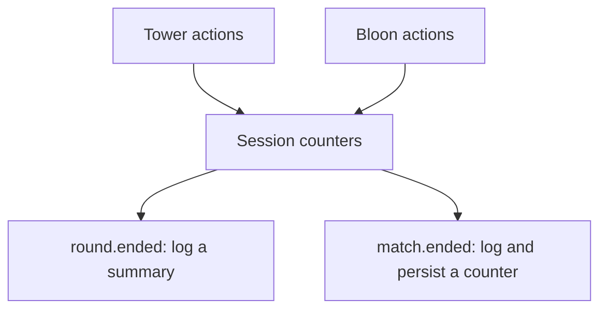

# Event Monitor

[All samples](../README.md) · [Event contract](../../docs/gameplay-events.md)

A read-only gameplay example that counts tower and bloon actions, writes a
summary after each round, and persists a completed-match counter in mod-owned
storage.

## Data flow

| Summary field | Order of values |
| --- | --- |
| `towers` | Placed / upgraded / sold |
| `bloons` | Spawned / popped / leaked |

Set `log_each_action` to `true` in the profile configuration to log each
observed object's kind and stable ID. The example also demonstrates retaining
subscription tokens and removing them during shutdown.

Counter summaries use this order:

- towers: placed / upgraded / sold;
- bloons: spawned / popped / leaked.

## Run it

1. Import `event-monitor.btd5mod`, enable it in an offline test profile, and launch.
2. Place a tower, play a round, upgrade it, and sell it. Inspect the round summary
   in the runtime log; values are cumulative for the session, not reset per round.
3. Exit the match to observe the match summary and stored count. This counts
   observed `match.ended` events, including leaving a match, not just victories.
4. Relaunch to confirm the stored count continues across sessions. It belongs
   to this mod ID, so other profiles using the same mod share the stored value.
5. To inspect each action, set `log_each_action=true` and relaunch. Leave it off
   for ordinary use because bloon events can be frequent.

The script keeps subscription tokens and removes them on normal shutdown.
Source: [manifest](mod.json), [Lua](lua/main.lua).
