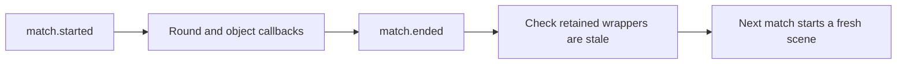

# Lifecycle Sample

[All samples](../README.md) · [Live harness](../../docs/building.md#live-game-acceptance)

This is the comprehensive acceptance fixture. For a small first mod, use
[Hello World](../hello-world-mod/README.md). Keep the test switches below off
unless deliberately running their scenario; some handlers use assertions and
produce verbose output.

## Match-cycle checks

The full fixture covers all 28 events. Attack/projectile observation and the
mutation probes are opt-in; keep their test switches off for ordinary learning.

To run manually, import `lifecycle-sample.btd5mod`, enable it in an offline test
profile, and launch. Inspect lifecycle and gameplay messages in the runtime log.
The [manifest](mod.json) lists every setting and default; the
[script](lua/main.lua) is the exact contract exercised by the harness probes.

This publishable sample uses only the sandboxed Lua API. It logs each lifecycle
stage, persists a launch counter in mod-owned storage, reads configuration and
localization, schedules a deterministic timer, and logs all live match and
round lifecycle events plus cash, lives, and tower
placing/placed/upgrading/upgraded/selling/sold notifications. The tower handlers
demonstrate stable wrapper identity and pre/post action ordering as well as
post-sale invalidation. Bloon handlers log pre/post spawn, pop, and leak
identities, verify action ordering, and verify post-pop and post-leak
invalidation.
Lives handlers verify matching `old_lives` and `new_lives` values across the
exact pre-write and post-change notifications.

The `cancel_lives_loss` setting defaults to `false`. When explicitly enabled,
the sample cancels life-loss writes from `lives.changing` while leaving the
originating bloon leak intact. It is intended for the dedicated cancellation
smoke test and is not enabled during ordinary sample use.

The `mutate_lives_loss` setting also defaults to `false`. The dedicated
mutation smoke test enables it to replace a proposed life loss with a one-life
gain. The resulting `lives.changed` event must contain the replacement value,
which proves the Lua mutation reached the native commit boundary. Do not enable
this test-only behavior during ordinary sample use.

The `mutate_tower_pop_count` setting defaults to `false`. Its dedicated live
smoke test reads a newly placed tower's pop count, changes it to `123` through
the validated wrapper setter, reads it back, and logs the transition.

The `cancel_tower_actions` setting defaults to `false`. Its dedicated smoke
test cancels accepted upgrade and sale attempts before their first side effect.
The tower remains placed and valid after both rejected actions.

The `mutate_direct_properties` setting defaults to `false`. Its dedicated smoke
test changes a placed tower's sell price to `777` and adds one health to a
spawned bloon, then reads both values back through their wrappers.

The `test_identity_cash` setting defaults to `false`. Its dedicated smoke
test logs each placed or upgraded tower's type and tiers, every round number,
and each new bloon type. At the first round start it raises cash by 500 with
`match:set_cash()` and then restores it, checking that `cash.changed` reported
each value before the call returned.

The `cancel_bloon_spawns` setting defaults to `false`. When enabled, the sample
cancels the first three round spawns (`event.from_round`). Each cancelled
wrapper must be stale a frame later, must never reach `bloon.spawned`, and the
round must still end.

The `cancel_bloon_pops` setting defaults to `false`. When enabled, the sample
cancels the first lethal hit on up to three bloons. Each must stay valid with
positive health and then pop normally on a later hit.

The `cancel_tower_placement` setting defaults to `false`. When enabled, the
sample cancels the first player purchase it sees and allows later ones. The
live smoke harness's `--expect-placement-cancellation` scenario enables it: try
to place a tower (it stays on the cursor and no cash is spent), then place it
again.

The `test_mutation_match` setting defaults to `false`. When enabled, the
sample turns on every implemented mutation for the whole match. It cancels the
first purchase, upgrade, sale, and bloon leak attempt it sees, and lets the
next attempt through. It sets the placed tower's pop count and sell price, and
adds one health to each of the first spawned bloons. It cancels the first
lives loss and replaces the second with a one-life gain. After the match ends,
it checks that retained tower and bloon wrappers are stale. The live smoke
harness's `--expect-mutation-match` scenario enables it.

The `observe_attacks_projectiles` setting defaults to `false`. When enabled,
the sample tracks every attack and projectile wrapper, logs the first three
lifetimes of each kind, and confirms that a destroyed wrapper becomes stale.
The live smoke harness's `--expect-attack-projectile` scenario enables it:
enter a match, place a tower, let it fire, then sell it.

The opt-in `cancel_bloon_leaks` setting is used by the live smoke harness's
`--expect-bloon-cancellation` scenario. Start a fresh Easy match without towers
and let bloons reach the exit. The harness checks cancellation, continued handle
validity, and absence of leak/lives transitions, then closes the game normally.
