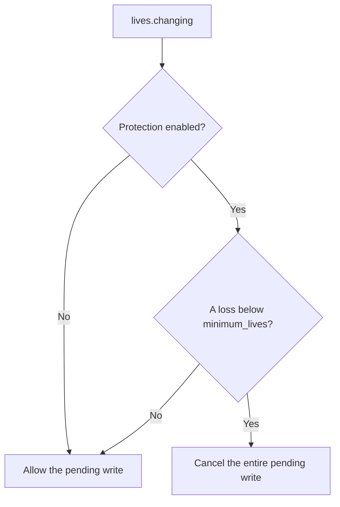

# Lives Guardian

[All samples](../README.md) · [Lives contract](../../lua-api/reference.md#lives-events)

A focused mutation example using the supported lives-write cancellation path.

## Life-loss decision

With the default floor of 1, a proposed `2 → 0` stays at **2**. The sample
rejects the whole loss rather than replacing it with 1. The bloon still leaks.

When enabled, a loss that would reduce the player below `minimum_lives` is
cancelled at the exact native lives-write boundary. The originating bloon still
leaks; only the lives write is skipped. Gains and losses that remain at or above
the configured minimum are unchanged.

Configuration:

- `enabled`: set to `false` to disable protection;
- `minimum_lives`: non-negative integer floor, default `1`.

This example requests `gameplay.mutate` because it changes the result of a live
game action.

## Run it

1. Import `lives-guardian.btd5mod` and enable it in an offline test profile.
2. Leave `enabled=true`, set `minimum_lives` to a value near the match's starting
   lives, and launch. Start a round without towers.
3. Losses that stay above the floor commit normally. A loss crossing the floor
   is cancelled in its entirety; this sample does not clamp lives to the floor.
4. Inspect `Lives Guardian cancelled` records in the runtime log.
5. Set `enabled=false` and relaunch to observe ordinary life loss.

Source: [manifest](mod.json), [Lua](lua/main.lua). This is one of several
supported cancellation boundaries; see [all events](../../docs/gameplay-events.md).
