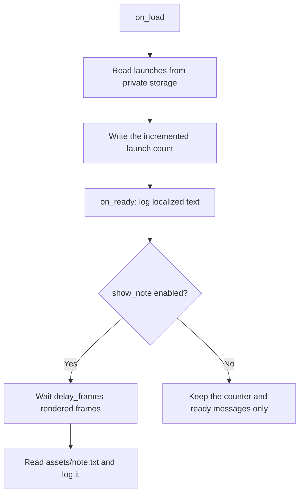

# Resource Notes

[All samples](../README.md) · [Authoring tutorial](../../docs/mod-authoring.md)

A small non-gameplay example of configuration strings, private persistent
storage, English localization, packaged text resources, frame timers, and an
optional load-order constraint. It uses no filesystem or module-loading APIs.

## Read, persist, and display

| Data | Source | Lifetime |
| --- | --- | --- |
| `show_note`, `delay_frames` | Profile configuration | Per profile |
| `launches` | Mod-private string storage | Shared by this mod ID across launches/profiles |
| Ready text | `localization/en-US.json` | Packaged translation |
| Note | `assets/note.txt` | Packaged text resource |

## Run it

1. Import `resource-notes.btd5mod` and enable it in an offline profile.
2. Launch and open the runtime log. `[Resource Notes]` records show the launch
   count, localized ready text, and note from `assets/note.txt`.
3. Exit normally and launch again. The count increases and survives the restart.
4. Set `show_note` to `false` and relaunch. Counter and ready text remain; the
   note is omitted. `delay_frames` defaults to 60 and is clamped to integer
   `0..600`; frames are not seconds or simulation ticks.
5. Optionally enable Hello World too. `load_order.after` requests that Resource
   Notes loads after `example.hello-world` when present. Hello World is not a
   required dependency; Resource Notes also runs alone.

Storage belongs to `example.resource-notes` across versions and profiles. It is
not a profile setting, game save, or backup. This sample writes the counter
during `on_load`, so normal shutdown is not required to persist that write.

The current runtime reads a flat `localization/en-US.json` table. A missing
translation returns the key; there is no placeholder formatter or locale picker.
`resource.read_text` reads a packaged relative path with a 1 MiB limit, not an
absolute path. The localization and text files must remain inside the archive.

Source: [manifest](mod.json), [Lua](lua/main.lua),
[translations](localization/en-US.json), [note](assets/note.txt).
