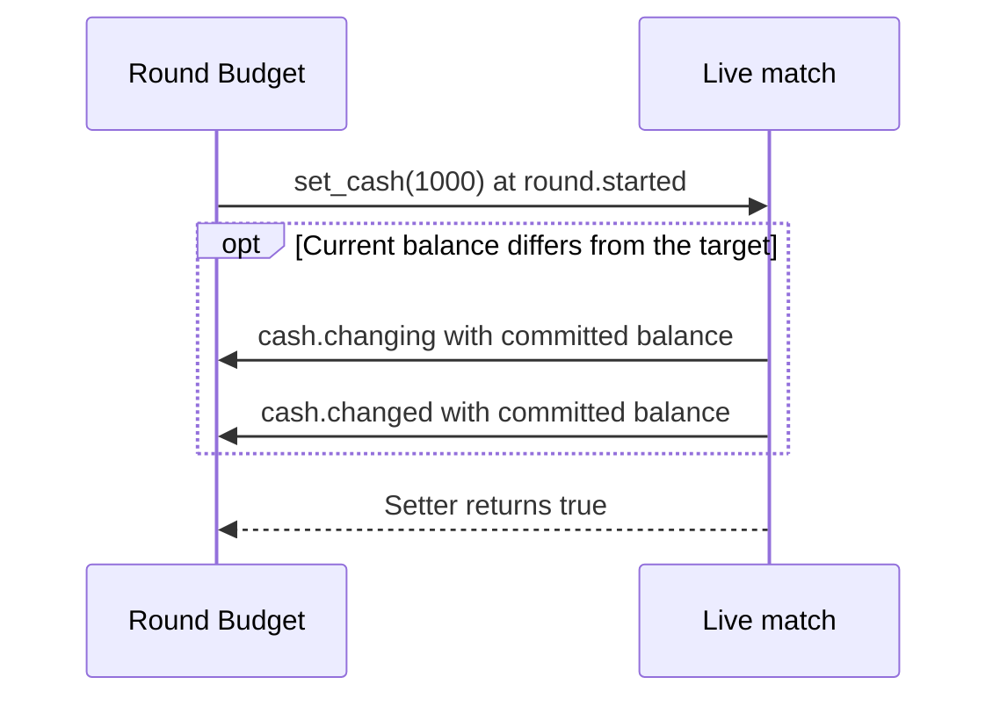

# Round Budget

[All samples](../README.md) · [Cash API](../../lua-api/reference.md#match)

A focused example of retained match handles, round numbers, cash notifications,
and `match:set_cash()`. Gameplay changes default to off.

## Synchronous cash update

| Balance before the round | Target | Result |
| --- | --- | --- |
| 650 | 1000 | Raise cash to 1000 |
| 1400 | 1000 | Reduce cash to 1000 |
| 1000 | 1000 | No change event |

These examples require `enabled=true`; the package defaults to disabled.

## Run it

1. Import `round-budget.btd5mod`, enable it in a test profile, and configure it.
2. Set `enabled` to `true` and `round_cash` to `1000`.
3. Launch offline, enter a fresh match, and start round 1. The balance becomes
   exactly 1000, including reducing it if it was higher.
4. Spend or earn cash, then start another round. The balance is reset once at
   that round's start. Check `[Round Budget]` records in the runtime log.
5. Exit the match and enter another; the old handle is discarded. Set `enabled`
   to `false` and relaunch to keep the sample read-only.

| Setting | Default | Meaning |
| --- | --- | --- |
| `enabled` | `false` | Set the absolute balance at each `round.started` |
| `round_cash` | `1000` | Target balance, clamped to integer `0..2147483647` |

`cash.changing` is already a committed-balance notification. Changing its fields
or cancelling it does not set cash. The setter uses native add/spend helpers and
dispatches cash events synchronously; this sample only observes them and writes
from a round callback to avoid recursion. If the balance already equals the
target, the setter emits no change. Other mods may change it afterward.

Source: [manifest](mod.json), [Lua](lua/main.lua). Follow the
[authoring tutorial](../../docs/mod-authoring.md) to package an edited copy.
